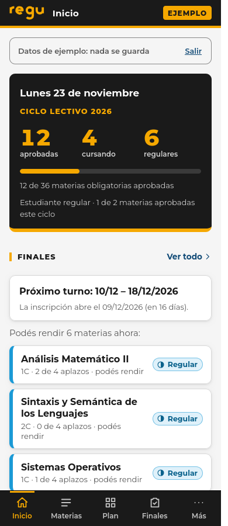
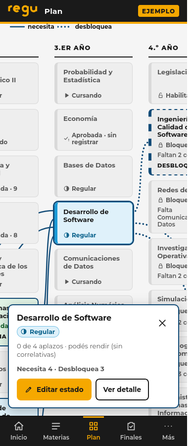
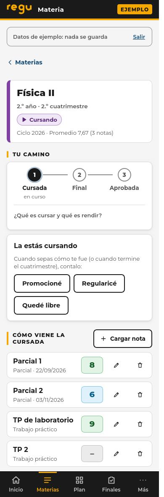
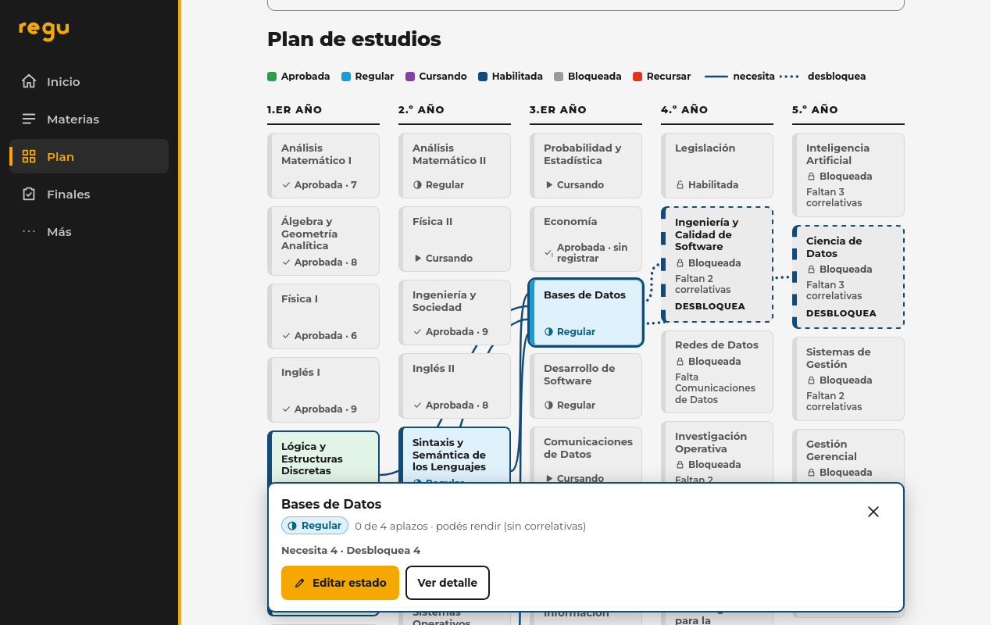

# Regu

**Tu cursada en la UTN FRVM, en un solo lugar.**

Regu es una aplicación web personal para estudiantes de la **UTN Facultad Regional Villa María**. Responde en un vistazo las preguntas que hoy obligan a cruzar a mano el plan de estudios, el reglamento, las planificaciones de cátedra, autogestión y el campus virtual:

- ¿Qué puedo **cursar** el próximo cuatrimestre?
- ¿Qué puedo **rendir** y hasta cuándo me alcanza la excepción de correlativas?
- ¿Cómo vengo en cada materia?
- ¿Qué fechas tengo encima: turnos de final, inscripciones, cierres?

Es **local y sin cuentas**: tus datos quedan en tu dispositivo.

> **Proyecto independiente. No es una aplicación oficial de la UTN** ni de la Facultad Regional Villa María. Los cálculos siguen la Ordenanza 1549 y las planificaciones de cátedra, pero la fuente de verdad siempre es autogestión.

## Estado

El MVP está **completo y probado**. Las reglas de aprobación están cargadas solo para las 8 materias de **1.er año**, todavía sin confirmar con la cátedra. El detalle de lo hecho, lo que falta y las decisiones tomadas está en [`ESTADO.md`](ESTADO.md).

## Capturas

<p>
  
  
  
</p>



*Capturas del modo de ejemplo, con datos inventados.*

## Qué hace

- **Disponibilidad:** qué podés cursar y qué podés rendir, con el porqué de cada respuesta. Aplica las reglas de la Ord. 1549: correlativas al inscribirse, excepción de las últimas materias, correlativas que no se exigen al rendir dentro del ciclo lectivo siguiente al cursado, límite de 4 aplazos (los ausentes no cuentan) y condición de estudiante regular.
- **Camino de cada materia:** Cursada → Final → Aprobada, con una sola acción por estado. Cuando cursás, contás cómo te fue (promoción, regular o libre) y se ve en el momento.
- **Notas de la cursada y qué te falta:** cargás parciales, trabajos prácticos y recuperatorios; ves el promedio y la mínima. Para las materias de 1.er año, la app compara tus notas con la regla de la planificación 2026 de la cátedra (con la fuente y las dudas a la vista) y te dice si por las notas cumplís, no cumplís o todavía no se sabe. La asistencia y los laboratorios los listás aparte porque la app no los conoce. No promete resultados.
- **Mapa del plan:** el plan por año, con los caminos entre materias al elegir una (qué necesita, qué desbloquea).
- **Finales y calendario:** turnos de final, mesas móviles, inscripciones con el cierre a 48 h hábiles, y el calendario académico, que podés completar cuando la facultad publica fechas nuevas.
- **Progreso:** promedios con y sin aplazos, electivas, requisitos y avance hacia el título intermedio y el final.
- **Backup:** exportás e importás tus datos en un archivo.
- **Funciona sin conexión** y se instala como app (Android e iOS), con tema claro y oscuro.

## Cómo está pensado

- **Local primero.** Sin cuentas: los datos viven en IndexedDB y se respaldan en un archivo. Lo único con servidor es «Contanos» (`api/feedback.ts`), para mandar comentarios.
- **Un motor puro.** El estado de una materia **se calcula** a partir de los hechos cargados (cursadas, finales, notas, correcciones) y de la fecha; nunca se guarda. Es una función de `(plan, calendario, datos, fecha)`, así que se prueba con cualquier fecha.
- **Datos de referencia separados de los tuyos.** El plan y el calendario son archivos versionados que se validan al arrancar; tus datos los referencian por id.
- **Honestidad con lo que no se sabe.** Lo que la facultad no publica (horas de electivas, correlativas de las electivas del plan 2023) queda marcado "por confirmar" y no se presenta como un hecho.

Más en [`docs/idea.md`](docs/idea.md) y [`docs/prd.md`](docs/prd.md).

## Empezar

Requisitos: **Node ≥ 22.12** para compilar y servir la app. Las pruebas ejecutan TypeScript directamente con Node y se verificaron con **Node 26**; no se probaron con versiones menores. Las pruebas en navegador necesitan **Firefox** instalado.

```sh
git clone git@github.com:Facundo-Gauna/Regu.git
cd Regu
npm install
npm run dev
```

Abrí la app con datos de ejemplo en `http://localhost:5173/?ejemplo=1` (se guarda solo en memoria, no toca tus datos).

### Comandos

| Comando | Qué hace |
|---|---|
| `npm run dev` | Servidor de desarrollo |
| `npm run build` | Compila la PWA en `dist/` |
| `npm run preview` | Sirve `dist/` como en producción |
| `npm test` | Tests del motor, los datos, la vista y la persistencia |
| `npm run typecheck` | Chequeo de tipos del motor y de la app |
| `npm run validar-datos` | Valida el plan y el calendario |
| `npm run check` | Tipos + validación + tests + compilación |
| `npm run e2e` | Pruebas de extremo a extremo en un Firefox real |
| `npm run iconos` | Regenera los íconos desde `src/app/marca.ts` (requiere `rsvg-convert`) |

### Qué cubren las pruebas

`npm run check` corre los tests unitarios (motor, datos, vista, persistencia con IndexedDB simulada). `npm run e2e` maneja la app dentro de un Firefox real, como lo haría una persona: primer uso, cargar y recargar, uso sin conexión, cursadas, finales y notas, calendario, backup (exportar, borrar todo, importar), modo ejemplo y la barra lateral de escritorio. Con `E2E_PREFIJO=/subcarpeta/ npm run e2e` repite todo con la app servida bajo una subcarpeta.

No se probó todavía en dispositivos Android ni iOS reales, ni en Chrome o Safari.

## Deploy en Vercel

Regu es una carpeta de archivos estáticos y funciona sin servidor ni variables de entorno. La excepción es «Contanos», que necesita la función de Vercel y tres variables (ver [`ESTADO.md`](ESTADO.md)). **Todavía no está desplegada**, y los pasos de Vercel no se probaron desde acá.

1. En Vercel: **Add New → Project** e importá `Facundo-Gauna/Regu`.
2. El preset es **Vite** (se detecta solo): comando `npm run build`, carpeta de salida `dist`.
3. Usá Node 22 o superior (Ajustes del proyecto → *Node.js Version*).
4. Desplegá. Las rutas usan `#` y las referencias son relativas, así que no hacen falta reglas de reescritura y la app también funciona desde una subcarpeta.

[`vercel.json`](vercel.json) solo define cabeceras de caché: `sw.js` e `index.html` se revalidan siempre (para que las actualizaciones lleguen) y `assets/` se cachea de forma permanente. Para instalarla en el celular y que abra sin conexión hace falta **HTTPS**, que Vercel da por defecto.

## Estructura del repositorio

```
src/
  motor/          Reglas (TypeScript puro): estado, disponibilidad, calendario, progreso
  datos/          Datos del usuario: backup, acciones puras, validador, almacén, ejemplo
  vista/          Modelos de vista (filtros, inicio, mapa, agenda, notas, rutas): testeables en Node
  app/            La interfaz (Preact): store, IndexedDB, pantallas, estilos, marca
datos/            Datos de referencia (plan ISI 2023, calendario 2026/27) y esquemas JSON
docs/             Visión, requisitos, investigación de fuentes y capturas
herramientas/     Validador de datos, generador de íconos y prueba e2e
test/             Tests (node:test)
public/           Favicon e íconos de la PWA (generados)
planes/           Solo un README: los documentos de la facultad no se versionan
ESTADO.md         Estado del proyecto y lo que falta
```

## Documentación

| Documento | Contenido |
|---|---|
| [`ESTADO.md`](ESTADO.md) | Qué está hecho, qué falta y qué decisiones no revertir |
| [`docs/idea.md`](docs/idea.md) | Visión, modelo conceptual, reglas del reglamento y decisiones |
| [`docs/prd.md`](docs/prd.md) | Requisitos del producto y estado de cada uno |
| [`docs/investigacion.md`](docs/investigacion.md) | Qué dicen las fuentes: Ord. 1549, planes, calendario, planificaciones |
| [`datos/README.md`](datos/README.md) | Formato de los datos de referencia y del backup |
| [`planes/README.md`](planes/README.md) | De dónde salen los documentos de la facultad |

## Límites conocidos

- **Dos pestañas a la vez** (la app instalada y una pestaña del navegador): gana la última en guardar. Usá una por vez.
- **Los datos de referencia son una transcripción a mano** de documentos publicados por la facultad, y varios son imágenes escaneadas. Las dudas están marcadas en la app (Ajustes → Datos de referencia).
- **No hay conexión con autogestión ni con el campus virtual.** Un navegador no puede leer esos sitios sin que lo permitan, y entrar con tu usuario implicaría guardar credenciales en un servidor. La vía prevista es pegar las notas.

## Privacidad

Nada sale de tu dispositivo salvo lo que vos mandás desde «Contanos». No hay cuentas ni analíticas. Tus datos están en el almacenamiento del navegador; el backup en un archivo es lo que los recupera si el navegador los borra.

## Marca y créditos

La marca "regu" está dibujada con trazos propios y toma los colores y el estilo de la UTN FRVM (ámbar `#F5A800`, negro y blanco). **No usa el logo ni el asterisco oficial de la UTN.** La tipografía es [Montserrat](https://github.com/JulietaUla/Montserrat) con licencia SIL Open Font License; el texto de la licencia está en [`src/app/fuentes/MONTSERRAT-OFL.txt`](src/app/fuentes/MONTSERRAT-OFL.txt). Las ordenanzas, planes y planificaciones son de la UTN FRVM.

## Licencia

Sin definir todavía.
